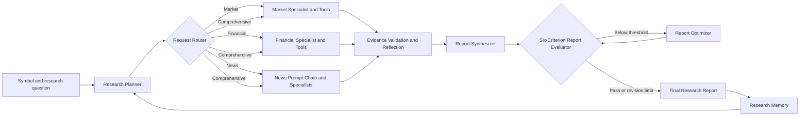

<!-- fullWidth: false tocVisible: false tableWrap: true -->
# Multi-Agent Financial Analysis System

An agentic AI investment research system that coordinates specialized agents\
to analyze market data, financial news, earnings, and company filings. The\
project demonstrates research planning, dynamic tool use, self-reflection,\
cross-run memory, prompt chaining, intelligent routing, and iterative analysis\
refinement.

> **Course:** AAI-520 — Natural Language Processing and Generative AI
>
> **Project:** Final Team Project — Multi-Agent Financial Analysis System

## Table of Contents

- [Project Overview](#project-overview)
- [Objectives](#objectives)
- [System Architecture](#system-architecture)
- [Agent Functions and Capabilities](#agent-functions-and-capabilities)
- [Required Workflow Patterns](#required-workflow-patterns)
- [Data Sources and Tools](#data-sources-and-tools)
- [Repository Structure](#repository-structure)
- [Getting Started](#getting-started)
- [Usage](#usage)
- [Evaluation and Iteration](#evaluation-and-iteration)
- [Memory and Learning Across Runs](#memory-and-learning-across-runs)
- [Project Deliverables](#project-deliverables)
- [Team and Contributions](#team-and-contributions)
- [Limitations and Responsible Use](#limitations-and-responsible-use)

## Project Overview

This project builds an autonomous Investment Research Agent that accepts a\
stock symbol and research question, plans a research strategy, gathers relevant financial\
information, routes that information to specialist agents, and produces a\
quality-controlled investment research report. The system is designed to make\
its reasoning process and workflow decisions observable in the final project\
notebook.

The system focuses on research support rather than automated trading or\
personalized investment advice.

## Objectives

The project has four primary objectives:

1. Plan an appropriate sequence of research tasks for a supplied stock symbol.
2. Select and use financial APIs, datasets, and retrieval tools dynamically.
3. Evaluate the completeness, factual grounding, and clarity of generated\
   analysis, then improve it using structured feedback.
4. Preserve brief notes from prior runs so future analyses can avoid repeated\
   issues and build on useful findings.

## System Architecture

The implemented workflow coordinates a research agent with several specialized\
agents and data tools.



## Agent Functions and Capabilities

### Research Planner

- Interprets the requested stock symbol and user research question.
- Creates a task plan based on available tools and required evidence.
- Uses prior-run feedback as bounded planning context.

### Tool-Using Research Agent

- Retrieves price history, company fundamentals, financial news, economic\
  indicators, and regulatory filings as needed.
- Records source metadata and retrieval times for traceability.
- Handles API errors, rate limits, and missing records gracefully.

### Specialist Agents

- **News Analyst:** identifies sentiment, catalysts, risks, and material events.
- **Earnings Analyst:** examines revenue, profitability, guidance, and earnings\
  trends.
- **Market Analyst:** evaluates price behavior, volatility, volume, and market\
  context.
- **Financial Analyst:** retrieves statements, computes revenue and earnings\
  growth, analyzes balance-sheet cash/debt, and incorporates SEC evidence.

### Report Synthesizer

- Combines specialist findings into a consistent research report.
- Separates sourced facts from interpretations.
- Highlights supporting and conflicting signals, risks, and data gaps.

### Evaluator and Optimizer

- Scores the draft against a defined quality rubric.
- Produces actionable feedback for weak or missing areas.
- Revises the report until it satisfies a quality threshold or reaches a\
  configured iteration limit.

### Memory Component

- Stores concise lessons, recurring data-quality issues, and prior research\
  notes.
- Retrieves only relevant memories for subsequent runs.
- Avoids treating outdated memories as current market evidence.

## Required Workflow Patterns

### 1\. Prompt Chaining

Financial news is processed through a sequence of focused stages:

```text
Yahoo Finance + NewsAPI (+ Google RSS fallback) -> Deduplicate -> Preprocess
                                                -> Classify -> Extract -> Summarize
```

Each stage produces a structured output for the next stage, making the process\
easier to inspect, test, and improve.

### 2\. Routing

The router examines the content type and sends it to the appropriate specialist.\
For example, an earnings release is routed to the Earnings Analyst, a material\
SEC filing to the Filings Analyst, and market-price data to the Market Analyst.\
Content may be sent to more than one specialist when multiple perspectives are\
needed.

### 3\. Evaluator–Optimizer

The system evaluates specialist news analysis with four 25-point criteria. A\
separate complete-report rubric scores completeness, grounding, reasoning,\
consistency, sources, and clarity. LangGraph sends failed reports through the\
optimizer and back to evaluation until the threshold or revision limit is\
reached. Initial/final scores, feedback, revisions, and graph trace remain\
inspectable in workflow state.

## Data Sources and Tools

Yahoo Finance, SEC EDGAR, NewsAPI, and Google News RSS are implemented sources.\
Additional providers are kept in separate adapter packages so they can be added\
without coupling provider APIs to agent or analysis logic.

| Source                   | Status     | Intended use                                          |
| ------------------------ | ---------- | ----------------------------------------------------- |
| Yahoo Finance / `yfinance` | Integrated | Prices, company data, statements, cash flow, and news  |
| SEC EDGAR                | Integrated | Official company facts and recent 10-K/10-Q/8-K filings |
| FRED                     | Scaffolded | Macroeconomic indicators                              |
| NewsAPI                  | Integrated | Optional current company-news source                  |
| Google News RSS          | Integrated | Automatic fallback for sparse primary news results    |
| Alpha Vantage            | Scaffolded | Supplemental market and fundamental data              |

Provider-specific authentication, retrieval, parsing, rate-limit handling, and\
error translation belong under `src/data_sources/<provider>/`. Modules under\
`src/tools/` provide a provider-independent interface to agents and normalize\
records before analysis. This separation also allows a tool to combine or fall\
back between sources later.

All external information used in a report should retain its source and retrieval\
date. API credentials must be stored in environment variables and must not be\
committed to the repository.

SEC requests must identify the application. Set `SEC_USER_AGENT` in `.env` to a
descriptive value containing a monitored contact email, as shown in
`.env.example`.

Set `NEWS_API_KEY` to enable the second news source. When a primary provider
fails or Yahoo returns fewer than three articles, the workflow can query Google
News RSS and records all source counts and errors. `MAX_NEWS_ARTICLES`,
`EVALUATION_SCORE_THRESHOLD`, and `MAX_OPTIMIZER_ITERATIONS` control news volume
and article revisions. `REPORT_SCORE_THRESHOLD` and `MAX_REPORT_REVISIONS`
control complete-report evaluation. `RESEARCH_REQUEST` supplies the notebook's
default question.

## Repository Structure

The repository follows this structure:

```text
multi-agent-financial-analysis/
├── README.md
├── requirements.txt
├── .gitignore
├── .env.example
├── notebooks/
│   └── multi_agent_financial_analysis.ipynb
├── src/
│   ├── __init__.py
│   ├── state.py
│   ├── cli.py
│   ├── llm/
│   │   ├── __init__.py
│   │   ├── ollama.py
│   │   └── parsing.py
│   ├── agents/
│   │   ├── planner.py
│   │   ├── router.py
│   │   ├── market_agent.py
│   │   ├── financial_agent.py
│   │   ├── news_agent.py
│   │   ├── synthesis_agent.py
│   │   ├── evaluator.py
│   │   └── optimizer.py
│   ├── data_sources/
│   │   ├── README.md
│   │   ├── __init__.py
│   │   ├── base.py
│   │   ├── yahoo_finance/
│   │   │   ├── __init__.py
│   │   │   └── client.py
│   │   ├── sec_edgar/
│   │   │   ├── __init__.py
│   │   │   └── client.py
│   │   ├── fred/
│   │   │   ├── __init__.py
│   │   │   └── client.py
│   │   ├── news_api/
│   │   │   ├── __init__.py
│   │   │   └── client.py
│   │   ├── google_news/
│   │   │   ├── __init__.py
│   │   │   └── client.py
│   │   └── alpha_vantage/
│   │       ├── __init__.py
│   │       └── client.py
│   ├── tools/
│   │   ├── executor.py
│   │   ├── market_tools.py
│   │   ├── financial_tools.py
│   │   ├── registry.py
│   │   └── news_tools.py
│   ├── reporting/
│   │   ├── charts.py
│   │   ├── diagrams.py
│   │   └── console.py
│   ├── workflows/
│   │   ├── __init__.py
│   │   ├── research_workflow.py
│   │   └── news_pipeline.py
│   └── memory/
│       ├── curator.py
│       └── memory_store.py
├── data/
│   └── memory/
│       └── research_memory.json  # Runtime file, ignored by Git
└── tests/
```

Generated data, reports, notebook checkpoints, secrets, and other large or\
sensitive files should be excluded through `.gitignore` where appropriate.

## Getting Started

### Prerequisites

- Python 3.10 or later
- Git
- Jupyter Notebook or JupyterLab
- API keys for any selected credentialed data sources

### Installation

```bash
git clone <repository-url>
cd multi-agent-financial-analysis
python -m venv .venv
source .venv/bin/activate
python -m pip install -r requirements.txt
```

On Windows PowerShell, activate the environment with:

```powershell
.venv\Scripts\Activate.ps1
```

### Ollama Installation

```bash
curl -fsSL https://ollama.com/install.sh | sh
ollama pull llama3.2:latest
```

### Configuration

When `.env.example` is available, copy it to `.env` and add the required API\
credentials:

```bash
cp .env.example .env
```

Never commit the populated `.env` file or expose API keys in notebook output.

## Usage

[`notebooks/multi_agent_financial_analysis.ipynb`](notebooks/multi_agent_financial_analysis.ipynb)\
is the canonical project entry point. Start the configured Ollama model, then\
open the notebook:

```bash
ollama serve
jupyter lab notebooks/multi_agent_financial_analysis.ipynb
```

Run the notebook from top to bottom. The setup section only constructs the\
workflow; Section 7 performs two live runs for the same request, displays its structured\
artifacts, renders deterministic and model-generated reports, and displays the\
architecture diagrams, news summary graphs, and 10-year price graph. Set\
`DEFAULT_TICKER`, `RESEARCH_REQUEST`, and `OLLAMA_MODEL` in `.env` to change the defaults.

The same extracted workflow also has an optional terminal interface:

```bash
python -m src.cli
```

The terminal interface prints the combined report and displays news-analysis
and 10-year adjusted-price graphs when data is available.

### Testing

Run the offline test suite with:

```bash
pytest
```

The Ollama prompt smoke test requires a running local Ollama service and is\
disabled by default. Enable it explicitly with:

```bash
RUN_OLLAMA_TESTS=1 pytest tests/test_ollama_integration.py -v
```

## Evaluation and Iteration

Reports and specialist analyses are evaluated with measurable criteria such as:

- factual support and source traceability;
- coverage of market, earnings, news, and filing evidence;
- distinction between evidence and interpretation;
- identification of risks, contradictions, and missing data;
- clarity, organization, and usefulness of the final report; and
- successful completion of the required workflows.

The notebook retains initial specialist analysis, evaluator scores, feedback,\
and revised outputs to demonstrate the evaluator–optimizer cycle. Offline tests\
cover provider normalization, deduplication, prompt chaining, routing, scoring,\
optimization, orchestration, reporting, diagrams, and failure isolation.

## Memory and Learning Across Runs

The system will store short, inspectable research memories rather than silently\
changing model behavior. Each memory should include a timestamp and enough\
context to determine whether it remains relevant. Current API data takes\
precedence over prior-run notes whenever the two conflict.

## Project Deliverables

The final submission will include:

- a working, fully executed code notebook;
- visible demonstrations of the four autonomous agent functions;
- visible demonstrations of prompt chaining, routing, and the\
  evaluator–optimizer workflow;
- evaluation evidence and at least one feedback-driven revision;
- comments explaining the agent design, capabilities, evaluation, and\
  iteration process;
- a link to this GitHub repository in the notebook; and
- an exported PDF (preferred) or HTML version of the notebook for submission.

## Team and Contributions

<table>
<tr>
<th>

Team member

</th>
<th>

Primary responsibilities

</th>
</tr>
<tr>
<td>

Brandon Wirgau

</td>
<td>

- [x] Build financial statements tool

- [x] Implement Evaluator Agent

- [x] Implement Self-Reflection

- [x] Implement Optimizer

- [x] Define evaluation criteria / rubric

- [x] Implement Financial Agent

</td>
</tr>
<tr>
<td>

Arslan Isaac

</td>
<td>

- [x] Implement Router

- [x] Implement Planner Agent

- [x] Build Yahoo Finance market data tools

- [x] Calculate market metrics

- [x] Implement Market Agent

- [ ] Additional Person 1 task(s) hidden in screenshot

</td>
</tr>
<tr>
<td>

*Christina Sadiq*

</td>
<td>

- [x] Integrate memory with planning


- [x] Implement Synthesis Agent


- [x] Implement persistent memory


- [x] Build news retrieval tool


- [x] Build prompt chaining news workflow (ingest to summarize)


- [ ] Additional Person 3 task(s) hidden in screenshot

</td>
</tr>
<tr>
<td>

Combined

</td>
<td>

- [x] End-to-end demo + learning-across-runs demo


- [x] Configure dependencies & environment


- [x] Full system testing (component, routing, evaluator, memory)


- [x] Define shared workflow state schema


- [x] Finalize project scope & MVP definition


- [ ] Additional Whole Group task(s) hidden in screenshot

</td>
</tr>
</table>

Team members will use issues, branches, pull requests, commits, and code reviews\
to coordinate work and document individual contributions.

## Limitations and Responsible Use

This project is an educational research prototype. Its outputs may be\
incomplete, delayed, or incorrect and should not be interpreted as personalized\
financial advice or as a recommendation to buy, sell, or hold a security. Users\
should verify important claims against primary sources and consult a qualified\
financial professional before making investment decisions.
